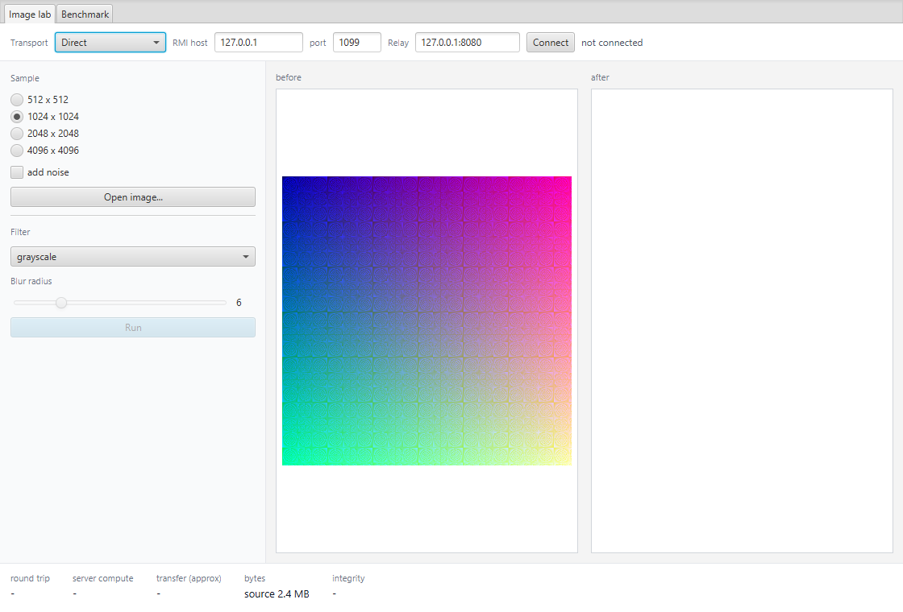
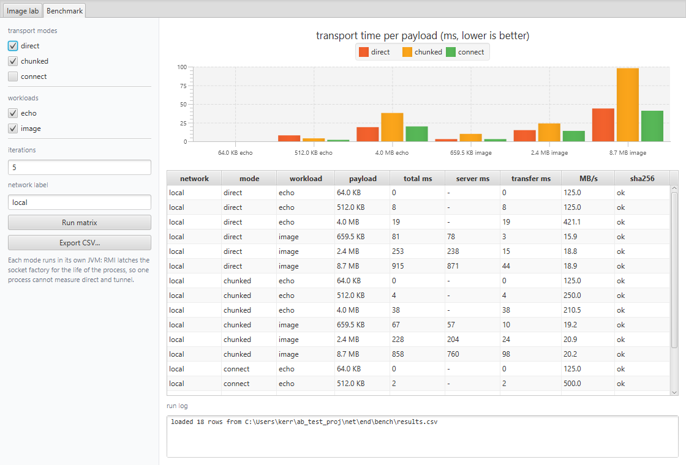

# ImageLab — RMI over an HTTP tunnel

A remote image-processing lab: a JavaFX client calls an RMI service that filters
images, and every RMI byte travels inside an HTTP/1.1 request instead of a raw TCP
connection. The tunnel is written from scratch — the JDK removed its own
RMI-over-HTTP socket factories long ago, so there is nothing to switch on.

```
client (JavaFX) --HTTP :8080--> relay --plain TCP--> RMI server
                                  |                  :1099 registry
                                  |                  :1100 exported object
                                  +-- one HTTP request per RMI connection
```

The relay is a real HTTP server: it speaks the protocol (request line, headers,
chunked framing, CONNECT), so any proxy that permits a long-lived POST or a
CONNECT will carry the tunnel.

## Requirements

* JDK 21 or newer (built and tested with JDK 25).
* Windows for the `.cmd` launchers; the Java code itself is portable.

## Run it

Three terminals, in this order:

```
dist\run-server.cmd       # RMI on 127.0.0.1:1099 and :1100
dist\run-relay.cmd        # HTTP on 0.0.0.0:8080
dist\run-ui.cmd           # the JavaFX client
```

In the client: transport `Tunnel (chunked)`, relay `127.0.0.1:8080`, press Connect.
Filter, radius and noise are live; every round trip prints its timings and a
SHA-256 check of both directions.

The same path from the command line, no window:

```
dist\run-cli.cmd --relay 127.0.0.1:8080 --size 1024 --filter blur --radius 6
dist\stop-all.cmd        # stop whatever is holding a port
```

## Run it across machines (LAN or Tailscale)

The client only ever dials the relay. The RMI endpoint name (`127.0.0.1:1099`) is
resolved *by the relay*, in the relay's network namespace, so it stays `127.0.0.1`
in every deployment.

1. On the server machine, start the server and the relay.
2. On the client machine run `dist\run-ui.cmd`, pick `Tunnel (chunked)`, and set the
   relay to `<server-ip>:8080` — the LAN address (`192.168.x.x`) or the Tailscale
   address (`100.x.x.x`).
3. Press Connect.

If it hangs, a firewall is dropping inbound TCP 8080 on the server machine.
Nothing else needs to be opened: ports 1099 and 1100 are bound to loopback only,
so they are unreachable from outside by construction. Confirm with
`netstat -ano | findstr :1099`.

## Why the ports look like that

| Port | Bound to | Who may connect |
| --- | --- | --- |
| 1099 registry | 127.0.0.1 | the relay, same machine |
| 1100 object | 127.0.0.1 | the relay, same machine |
| 8080 relay | 0.0.0.0 | whoever you allow |

Binding RMI to loopback is the entire access-control story: there is no firewall
rule to forget, and the tunnel cannot be bypassed. The relay's `--allow` flag
restricts which targets it will dial (default: loopback only; `*` allows anything).
An open relay would let anyone who reaches :8080 reach anything the relay can,
which is why the default is closed.

## The UI

* **Image lab** — pick a synthetic image, choose a filter (grayscale, posterize,
  sobel, blur), connect, press *Run*. Shows both images, the timings (round trip,
  server work, transfer) and the integrity verdict.
* **Benchmark** — runs the measurement matrix by spawning one child JVM per
  (workload, mode) pair, because RMI latches the global socket factory per
  process. Results land in `bench/results.csv` and in the chart and table.




## Command line tools

| Class | Purpose |
| --- | --- |
| `lab.client.TunnelClientMain` | one image round trip through the tunnel |
| `lab.client.DirectClientMain` | the same, without the tunnel (baseline) |
| `lab.bench.BenchMain` | measurement matrix -> CSV |
| `lab.tunnel.TunnelProbe` | raw byte pump through the relay, no RMI |
| `lab.tunnel.WireCapture` | prints the bytes of one handshake |
| `lab.server.ServerMain` | the RMI server |
| `lab.relay.RelayMain` | the HTTP relay |

```
java --module-path dist/lib --add-modules javafx.controls -cp "dist/app;dist/lib/*" \
  lab.bench.BenchMain --mode chunked --relay 127.0.0.1:8080 \
  --workload image --iterations 8 --network lan --out bench/results.csv
```

## Building

```
mvn -o clean compile     # compile only
make-dist.cmd            # rebuild dist/ (jars + launchers)
```

## Troubleshooting

| Symptom | Cause |
| --- | --- |
| `Port already in use: 1100` | an old server is still running: `dist\stop-all.cmd` |
| `Address already in use: bind` (relay) | same, for 8080 |
| `a different RMI socket factory is already installed in this JVM` | the client switched transport after connecting; restart it |
| Connect hangs, no relay log line | the request never arrived: wrong IP, or a firewall on 8080 |
| Connect hangs, relay log line present | the relay dialled the target and got nothing: is the RMI server up? |
| `ClassNotFoundException` / serialVersionUID mismatch | client and server built from different trees; rebuild both |

Details, measurements and the design rationale are in [REPORT.md](REPORT.md).
